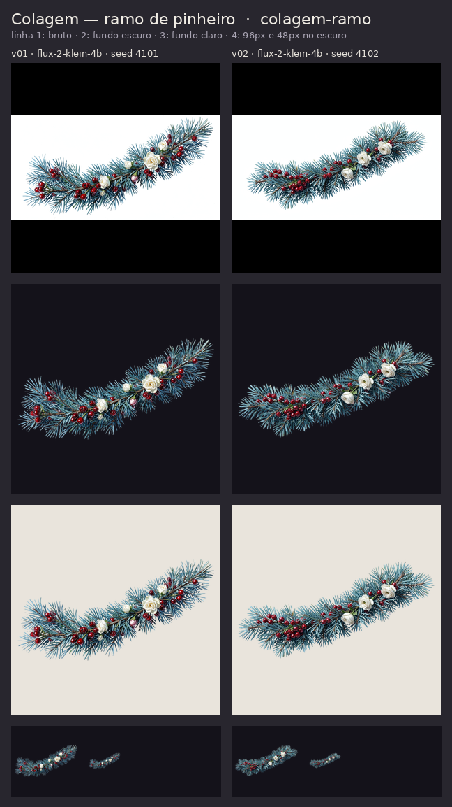

# Colagem — colar de perolas (`colagem-perolas`)

Tipo: **ilustracao** · tamanho original 2048px

| var. | modelo | seed | fundo | avisos/erro | arquivos |
|---|---|---|---|---|---|
| v01 | flux-2-klein-4b | 4101 | rembg:birefnet-general |  | [2047.png](final/colagem-perolas--v01--2047.png), [2047.webp](final/colagem-perolas--v01--2047.webp), [512.webp](final/colagem-perolas--v01--512.webp) |
| v02 | flux-2-klein-4b | 4102 | rembg:birefnet-general |  | [2047.png](final/colagem-perolas--v02--2047.png), [2047.webp](final/colagem-perolas--v02--2047.webp), [512.webp](final/colagem-perolas--v02--512.webp) |

Prompt:

> A long necklace of lustrous cream freshwater pearls with tiny antique gold beads between them, draped in a loose S-shaped curve with a few loose pearls at one end, photographed from directly above, each pearl with a gentle pink-cream sheen and a soft highlight. Realistic jewelry product photograph, sharp focus throughout. The object floats alone, centered with generous empty margin, on a plain flat pure white background, soft daylight from the upper left, no cast shadow.
