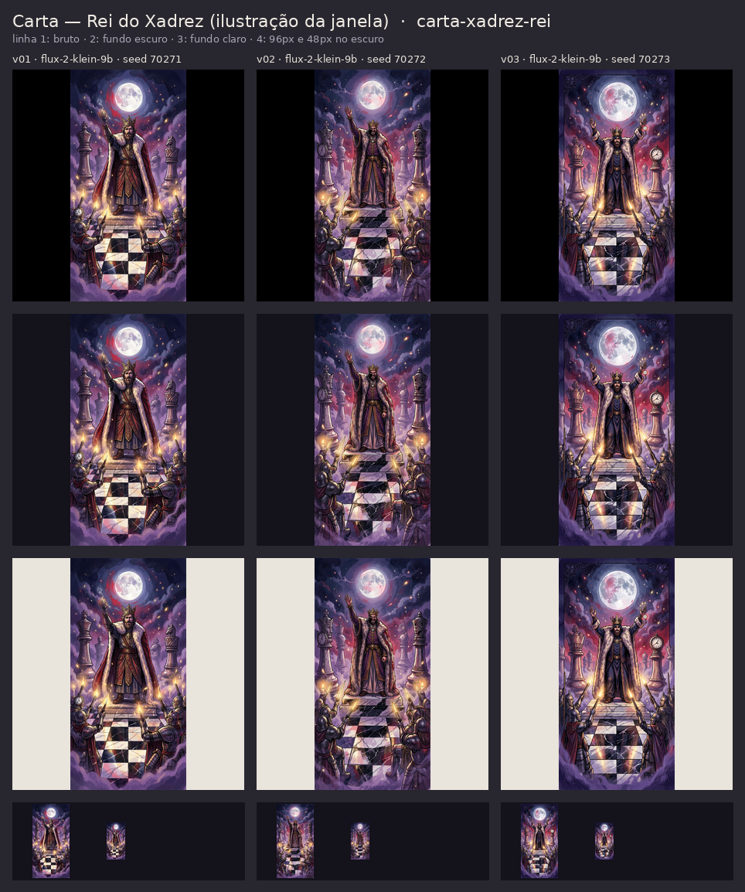

# Carta — Rei do Xadrez (ilustração da janela) (`carta-xadrez-rei`)

Tipo: **ilustracao** · tamanho original 1536px

| var. | modelo | seed | fundo | avisos/erro | arquivos |
|---|---|---|---|---|---|
| v01 | flux-2-klein-9b | 70271 | mantido |  | [1536.png](final/carta-xadrez-rei--v01--1536.png), [1536.webp](final/carta-xadrez-rei--v01--1536.webp), [1024.webp](final/carta-xadrez-rei--v01--1024.webp), [768.webp](final/carta-xadrez-rei--v01--768.webp) |
| v02 | flux-2-klein-9b | 70272 | mantido |  | [1536.png](final/carta-xadrez-rei--v02--1536.png), [1536.webp](final/carta-xadrez-rei--v02--1536.webp), [1024.webp](final/carta-xadrez-rei--v02--1024.webp), [768.webp](final/carta-xadrez-rei--v02--768.webp) |
| v03 | flux-2-klein-9b | 70273 | mantido |  | [1536.png](final/carta-xadrez-rei--v03--1536.png), [1536.webp](final/carta-xadrez-rei--v03--1536.webp), [1024.webp](final/carta-xadrez-rei--v03--1024.webp), [768.webp](final/carta-xadrez-rei--v03--768.webp) |

Prompt:

> Richly painted anime-inspired storybook illustration for a dark fantasy tarot card, full-bleed vertical scene that fills the whole tall narrow image edge to edge, portrait composition with the main subject in the center and atmospheric detail rising to the top and settling at the bottom. Fine ink linework, painterly gouache shading, intricate details, whimsical but dark mood, deep indigo and violet palette with crimson accents and warm candle-gold highlights, drifting glowing motes and soft fog. World of DEVO: a survival game of borrowed time where every player wears a ticking timer on the wrist, with clocks, tarot and masks everywhere. Chess collection: the scene stands on a vast polished black-and-white marble chessboard floor stretching into violet fog, colossal carved chess pieces loom in the background, cold moonlight with crimson and gold glints. A crowned king in a heavy ermine cloak stands on a raised dais delivering a commanding speech with one arm raised, his face half in shadow, armored soldiers in the foreground raise their weapons in devotion, a golden aura of inspiration rising from them. Absolutely no text, no letters, no words, no numbers, no numerals, no signature, no watermark, no logo, no card frame, no border, no ornamental frame, no panels, not a collage, not photorealistic, no 3d render.
